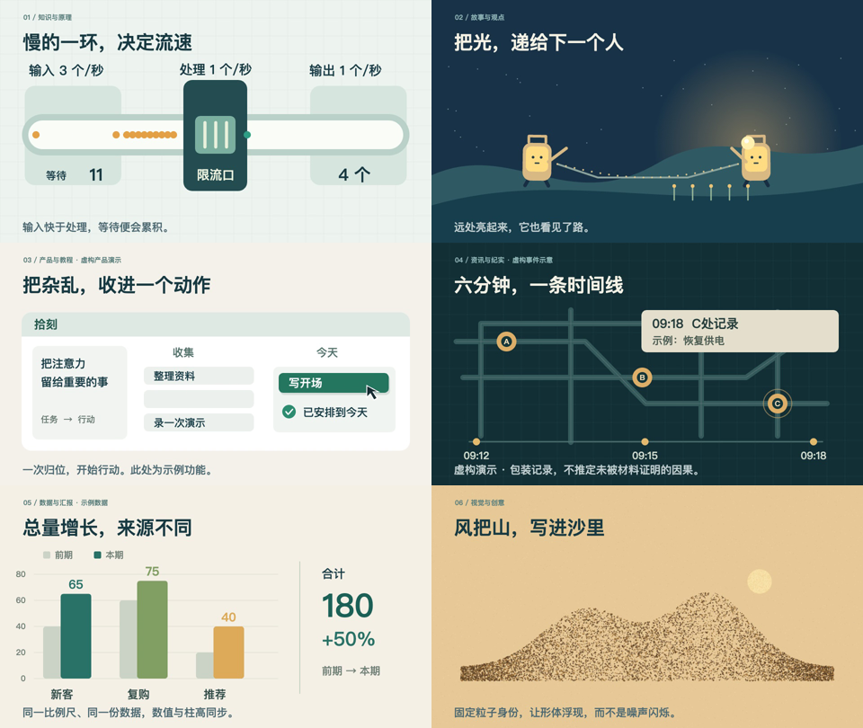

# Wattter 技能集

个人开源 AI 技能集合，通过 Plugin 市场分发，增强 Claude/Trae 等 AI 代理的自动化能力。

## 可用技能

### 内容发布与自动化
- **wtt-post-multi-platform**：多平台内容发布助手。用同一入口统一封装微信公众号 API 发布与知乎浏览器自动发布，各平台保留独立实现、配置与资源目录；需要把 Markdown 发布到不同内容平台时调用。
- **wtt-post-geo**：多平台 GEO 内容发布助手。通过“官方 API → 浏览器登录态 adapter → OpenCLI UI”分层路由，把同一份内容发布或创建草稿到微信公众号、微博、知乎专栏、CSDN、掘金、百家号、博客园、小红书、Twitter/X；统一处理平台格式、GEO 链接、媒体素材、防重复回退、状态校验与最终链接回报。微博默认生成并发布摘要短帖，只有用户明确要求时才走长文。

### 内容创作与 SEO
- **wtt-seo-geo-writer**：SEO / GEO 内容撰稿人。将输入内容转化为 SEO 或 GEO 优化的 Markdown 文章，主路径只有 SEO 与 GEO 两条；垂类品牌/行业语气作为可选 profile，仅在用户明确提及时加载。

### 信息采集与研究
- **wtt-info-collector**：基于配置驱动的通用信息收集助手。支持多数据源模块化扩展，自动采集、分析并生成结构化报告。
- **wtt-trend-radar**：多平台实时热点聚合与分析工具。支持从知乎、微博、抖音、B站等主流平台获取热搜数据，并根据关键词进行精准筛选。

### 产品与竞品分析
- **wtt-app-review-insights**：App Store 评论洞察分析工具。输入 App 名称、URL 或 App ID，自动抓取评论并通过 AI 深度挖掘产品痛点、机会、正面信号、用户分层、版本风险和行动建议，输出结构化洞察报告。

### 演示文稿与视觉表达
- **wtt-magazine-deck**：杂志风网页演示生成工具。支持生成自包含横向翻页 HTML deck，覆盖 editorial 与 swiss 两种风格，适用于分享、发布会、报告和作品展示。
- **wtt-course-pptx-builder**：课程 PPT 构建器。支持将 PDF、DOCX、URL、Markdown 等源文档转换为高质量 SVG 页面并导出为 PPTX，覆盖模板套用、AI 生图、图像搜索、实时预览、图表校准、动画定制和旁白生成等完整流程。
- **wtt-nine-image**：多风格图片提示词与封面制作。支持 9 号漫画恶搞科普、手绘信息图、四格漫画、克莱因蓝线条人、生活感人像五种提示词风格，外加「封面」类别——按内容自动选四种封面风格实际生成候选图；默认中文提示词，可直接用于 ChatGPT / 即梦 / Midjourney 等图片生成平台，封面真实排字附 OFL 授权手写字体。
- **[wtt-code-video-studio](wattter_skills/wtt-code-video-studio/README.md)**：代码视频工作室。把想法、文章或剧本做成代码动画和 MP4，也可单独交付剧本、分镜、提示词或指定片段。按内容检索 114 种风格，支持逐镜选风格、转场衔接、四帧审片、素材版本管理、个人旁白和多人对白。附风格图鉴、公开声线试听和拟音索引。
- **wtt-fin-chart**：财务图表生成器。将财务数据、经营指标、财报表格（CSV/Excel/PDF）转化为带洞察的 HTML 财务图表、仪表盘与经营分析页，同步输出长截图 PNG 备份，适用于董事会/投资人汇报与投研分析。

  <p align="center">
    
  </p>
  <p align="center">
    <video src="https://raw.githubusercontent.com/WaterDJiang/Wattter_openSkills/main/wattter_skills/wtt-code-video-studio/assets/examples/creative/final.mp4" controls width="72%" muted></video>
    <br><sub>示例短片《风把山，写进沙里》（960×540 / 8 秒 / 带旁白；六类完整样片见 assets/examples）</sub>
  </p>

### 视频创作流水线

四个独立技能覆盖从故事到成片的链路：**编剧 → 导演 → 制作 → 剪接**。可单独使用任意一环（如直接把剧本交给导演），也可按顺序接力；环节之间只通过交付文件交接，不要求全部安装。技能默认交付文字产物，实际生图/生成视频按你本机已接入的工具执行，不内置任何平台的调用。

- **wtt-video-screenwriter**：编剧。把点子、素材或已有故事开发为连续短剧、完整短片或独立单元，交付故事方案、人物设定、分集/分场大纲、可拍剧本与「编剧/场记/制作」三轮审校；支持连载承接与升级、短片情绪闭合、台词精修与逐项修订。
- **wtt-video-director**：导演。把剧本、故事或参考画面转为分镜表、空间光影与色光、镜头语言、声音设计与资产需求；每镜写清观众信息目标、机位起止路径、首尾状态与相邻镜头的接点依据，输出可直接制作的视听方案。
- **wtt-video-producer**：制作。把分镜整理为「每个角色一张卡、每个场景一张卡、每个视频片段一张卡」的提示词卡与全片共用关键帧卡，总索引集中登记资产对应、用法与版本；默认交文字制作包，明确授权后才驱动实际生成与逐镜检查。
- **wtt-video-editor**：视频剪接。用 FFmpeg（附 Python 脚本）把多段实拍或生成视频拼成成片：探测首尾帧接点、修剪重复动作、处理转场与原声衔接，交付可播放 MP4 与注明每处切点依据的剪接单。依赖 Python 3.10+ 与 FFmpeg。

### 旧设备与阅读工具
- **[wtt-kindle-revive](wattter_skills/wtt-kindle-revive/README.md)**：Kindle 检查、备份、固定组件部署与日常导书。设备上使用 WTT Reader 文字书架和大按钮控制，复用 KOReader、成熟微信读书插件与 SSH/SFTP；首台 PW1/5.6.1.1 已有本地与微信正文阅读反馈，Wi-Fi 真机传书尚未验收，其它机型需单独确认。支持把完整 Skill 目录交给 WorkBuddy 或其它本地 Agent 按说明执行。

### 知识库与项目工程
- **wtt-llm-wiki-builder**：LLM 友好知识库构建工具。支持三种模式：从零搭建 wiki 范式（Build）、增量编译新资料（Compile）、扫描修复已有 wiki 健康问题（Lint）。
- **wtt-project-harness-generator**：项目 Harness 生成器。扫描项目代码，通过对话引导理解项目 DNA，自动生成 CLAUDE.md 和 AGENTS.md，包含组件化、规则、UI/UX 等规范。

### 招聘与人才评估
- **wtt-resume-screener**：简历筛选与评估助手。输入 JD 与候选人简历（PDF/DOCX/Markdown），自动识别岗位级别（实习/校招/初级/中级/高级/专家/管理），从 HR 经理 + 业务负责人双视角进行评估，输出包含匹配度评分、维度拆解、双视角点评、推荐结论和面试重点的 Markdown 报告。

## 安装与使用

支持三种安装方式，按所用 Agent 选择。

### 方式一：Claude Code Plugin 市场（推荐）
本仓库已注册为 Claude Code Plugin 市场（`.claude-plugin/marketplace.json`），在 Claude Code 中直接安装：

```bash
# 1. 添加市场
/plugin marketplace add WaterDJiang/Wattter_openSkills

# 2. 按需安装单个技能，如 post-multi-platform
/plugin install wtt-post-multi-platform-skills@wattter-skills
```

插件名与 marketplace.json 的 `plugins[].name` 一致，格式为 `wtt-<技能名>-skills`。

### 方式二：Codex
Codex CLI 原生支持 Agent Skills 开放标准，把技能目录放入其技能目录即可被自动发现：

```bash
git clone https://github.com/WaterDJiang/Wattter_openSkills.git
mkdir -p ~/.codex/skills
cp -r Wattter_openSkills/wattter_skills/wtt-post-multi-platform ~/.codex/skills/
```

### 方式三：openskills（跨 Agent 通用）
适用于任何基于 AGENTS.md 发现技能的代理（Codex、Trae 等）：

```bash
openskills sync          # 将本仓库技能注册到 AGENTS.md
openskills read <技能名>  # 代理按需读取技能内容
```

### 调用技能
安装后直接向 AI 代理发出自然语言指令即可，例如：
"帮我把这篇文章发布到微信公众号。"
"帮我收集关于这个话题的信息。"

## 项目结构
- `wattter_skills/`：所有技能的源码和定义。
- `AGENTS.md`：AI 代理可用的技能清单文件。
- `.claude-plugin/`：Plugin 市场打包配置。

## 许可证
除各 Skill 或第三方文件另有明确许可外，本项目内容采用 [CC BY-NC-SA 4.0](https://creativecommons.org/licenses/by-nc-sa/4.0/deed.zh) 许可。`wtt-kindle-revive` 按其目录内 AGPL/GPL 等许可证与来源说明使用，不适用本仓库其它内容的非商业限制；微信插件仅提供上游获取配方，其用途和分发条件见上游声明。
