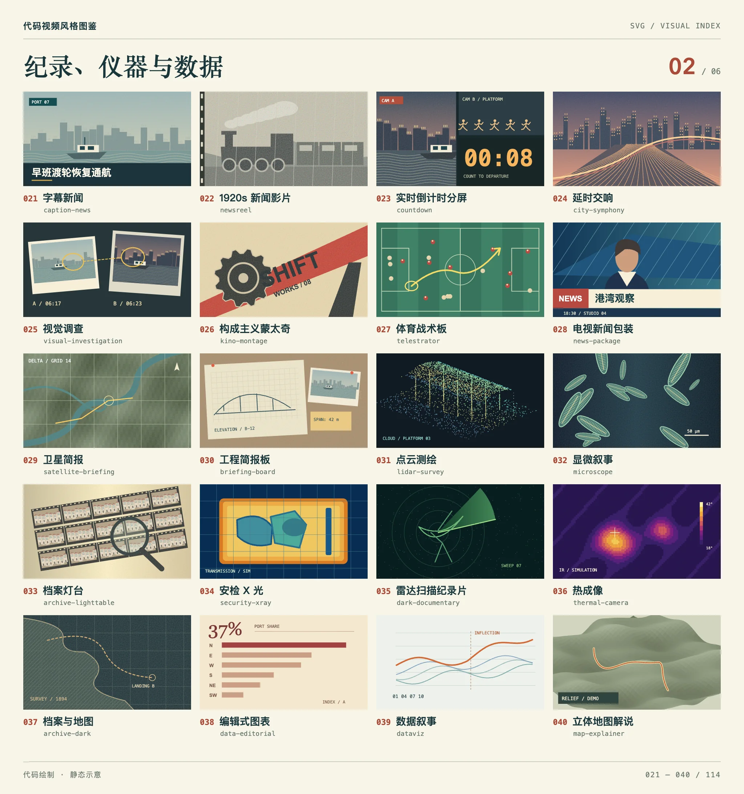
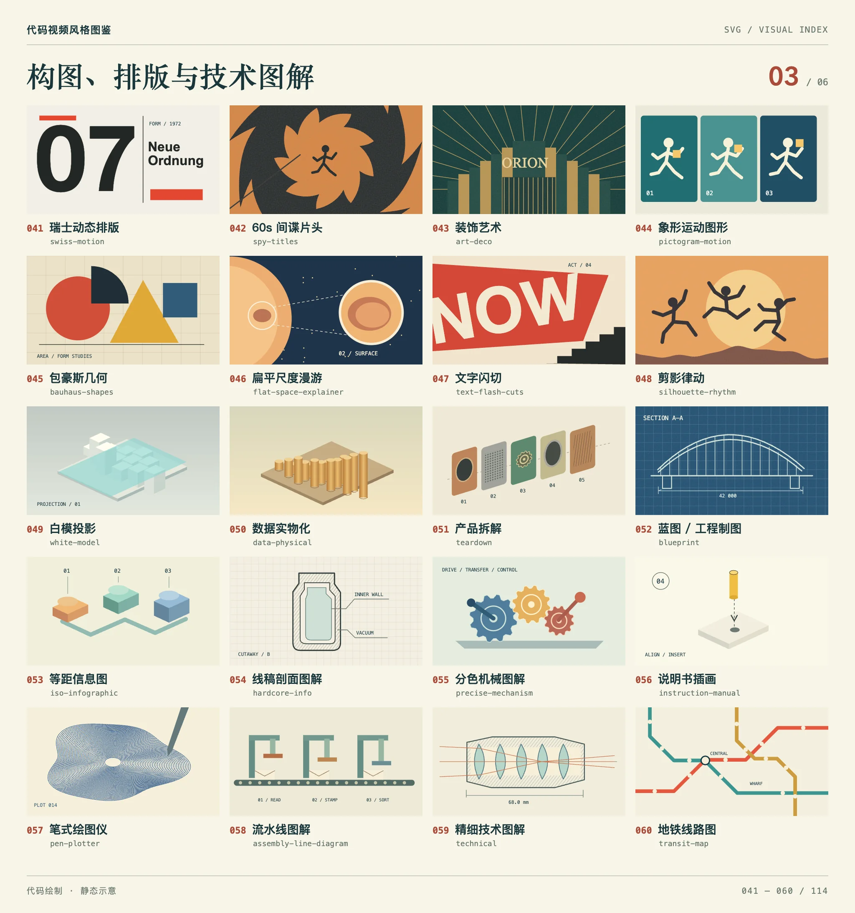
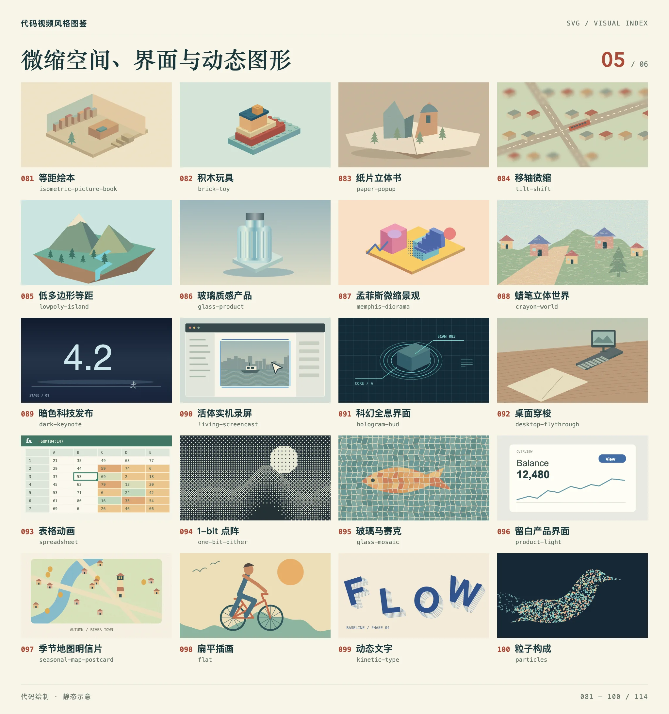
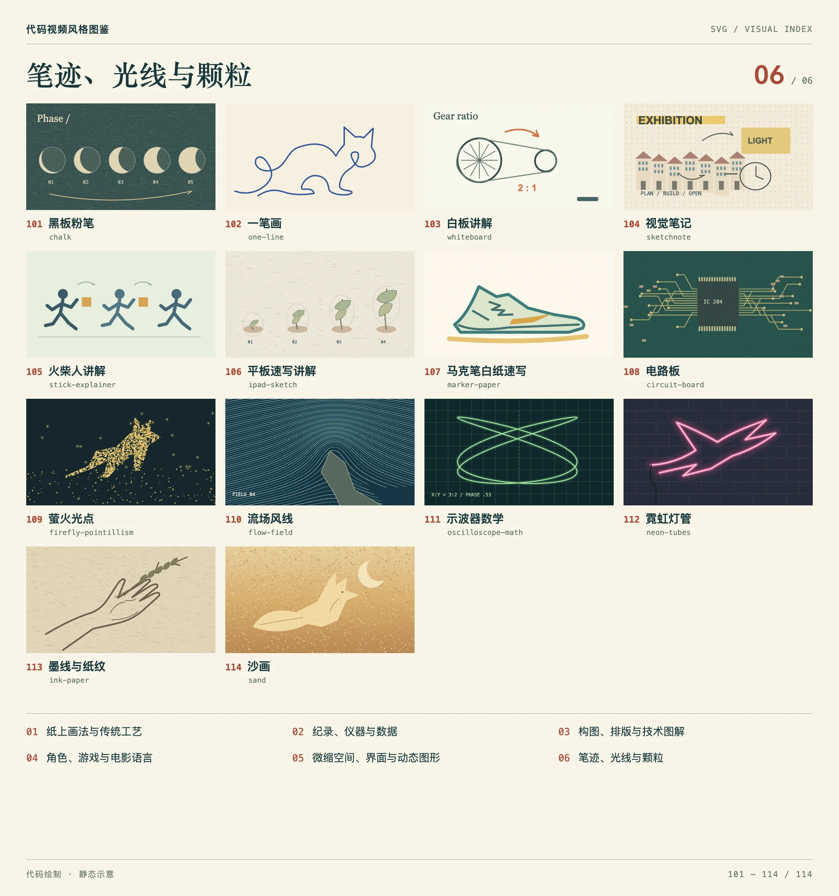

# 代码视频工作室

本项目自研内容编排、逐帧渲染、素材审阅与配音流程，把想法、主题、文章或剧本变成中文剧本、分镜、代码动画、配音和MP4。由前端逐帧绘制，经浏览器/专项导出器与FFmpeg输出；时长按内容和真实旁白决定，不固定30秒。

**新视频先选方向，再看四帧，确认后才完整渲染。** 已指定画风免五选；仍须看本片真实代码生成的四张样帧拼图。文字、图、交互、剧本和纯音频可单独交付；纯音频不执行视频四帧门。已有获批成片只换声音可走下文专用后期入口，任何画面/时序变化仍重新审片。

## 怎么用

把本目录按[仓库安装说明](../../README.md)安装，保留scripts/assets/config/references。无需安装本仓库全部Skill。对话示例：

> 使用wtt-code-video-studio，把“第一次学会骑自行车”做成温暖幽默的动画，横屏，时长按内容决定。先推荐五种方向，配音用已配置的个人音色；先给四张样帧拼图，我确认后再渲染。

> 使用wtt-code-video-studio，做广州秋季的孟菲斯微缩明信片。配色鲜明，1080方形、20秒、60fps，片内连续换角度。先查地点与地标、匹配当地声音，再给四帧拼图。

> 把这份文章做成知识寓言，故事快结束再揭示概念，故事后解释映射和边界。这次只交剧本，不做视频。

> 先做约10秒纯音频：旁白用我已配置的声音，角色A从疑问变为欣喜，角色B温和回应；同一角色保持同一声线。只做声音小样，不渲染视频。

既有剧本/锁定台词优先；普通文章会改编为可见动作，不逐段贴字幕。新主题在内部比较至多三种结构后择优，向用户提供五种完整方向（1首选+4备选），不是每次相同五个风格。选择后继续制作真实小样与四帧拼图，不增加脚本、配音等重复审批。

## 只做一个阶段，或让每镜用不同风格

你可以分几次发指令，中间拿走任何一份稿件：

> 把“一声回响”写成三段剧本，只给正文和对白。

> 沿用第二段原文，只出分镜。每镜给一个 ID，写出起止画面和为什么这样拍，画风稍后定。

> wall 镜用剪纸，trace 镜用示波器。先只给 trace 的视频提示词，我拿去生成。

> 先把 trace 做成独立小样。等两镜都定了，再按 wall → trace 组装，保留同一套字幕和声音。

文字阶段交到所要的稿件为止。请求整片时默认一条龙；单镜与整片分别确认各自的四帧。可复跑的[双镜示例](assets/examples/echo-shots/sequence.json)与[分段用法、提示词及组装命令](references/staged-creation.md)。

逐镜换风格时可以共享同一套姿态、轨迹和相机，让笔触在运动中改变。可直接说“第一镜用彩铅，第二镜用绘图仪线描，让同一摆锤继续摆，不要重新起摆”。示例含可运行的[共享状态与接镜命令](references/style-continuity.md)。

## 四张样帧怎样确认

每张来自当前工程的真实绘制代码，2×2排布，标帧号与时码，覆盖建立/变化/细节/收尾；不拿四张AI方向图或全白首尾充数。高风险运动另做短动作自查，静帧不证明动画已经通过。

agent会展示实际拼图，等你对该版本明确确认，再记录原话、样帧/拼图和源码/时间轴/素材哈希，继续完整渲染。普通“继续”、五选中的A、自动检查通过都不等于四帧批准。

相同工程原样重跑复用有效确认；画面/时序/素材变更会使旧批准失效，修正后给你看新版。旧片只改字号，不重编剧、不重做未变声音、不重选五方向，但新画面仍要确认。素材本身变化还需单独走diff审阅，二者不混用。

具体命令及版本记录见[四帧审阅](references/preview-review.md)。未确认时只交样帧待审，不能将新版本标记为整片验收通过。

## 从内容找形式与画风

六类用途：知识与原理、故事与观点、产品与教程、资讯与纪实、数据与汇报、视觉与创意。进一步有24种具体用法，覆盖广告、个人宣传、纪实、浪漫电影、概念解释、地理推演等，与114项风格形成239条多对多关系。一般调用直接识别，不新增开场分类问卷。

战役进攻、人口迁徙、贸易路线、疆域/交通演变和传播路径，会在五方向推荐前识别为“地理推演与空间叙事”，按空间因果推荐合适表现，不默认套地方明信片。可比较真实地形、卫星纪实、古地图版画、水墨山河或三维沙盘，具体五项随内容和数据条件变化。展示城市季节与生活氛围仍用地图明信片；三维路线须另备真实几何/高程并适配，不因进入推荐就视为已安装后端。

[完整风格库](assets/gallery/styles.html)可按用法、用途、组别和关键词筛选；[分类导航](references/classification.md)与[映射表](references/use-case-mapping.md)供完整浏览。附件15组99项全部可查，旧版66项沿用固定参考，其余33项按本库流程独立编写配方，加本库15项；数量与样片数量分开，收录不代表全部已渲染。

agent日常先看摘要，选定再深入：

```sh
python3 scripts/catalog.py list --use-case 个人宣传 --view summary
python3 scripts/catalog.py list --purpose knowledge --view summary
python3 scripts/catalog.py list --use-case 地理推演 --view summary
python3 scripts/catalog.py show desktop-flythrough --use-case 个人宣传
python3 scripts/catalog.py cases --use-case 概念解释
```

旧list完整JSON默认兼容；显式分页才截取，并标总数与源目录顺序，不能拿前五项当推荐排名。映射中的标题/关键镜头是未渲染构想，不等于已有成片。选中风格读取本地原创配方或该条已有的完整SOURCE和[保真方法](references/style-fidelity.md)，不把全部来源一次加载。

角色可以用沙、粒子、墨线呈现；叙事类型与材质、技术分别选择。Canvas/SVG、p5.js/p5.brush、Three.js/WebGL、GSAP、D3、Remotion是可选技术，未安装/未适配不冒称可直接运行。已有Three.js单片成功通过通用帧接口接入，仍不代表内置通用3D脚手架；[案例技术指南](references/case-driven-techniques.md)区分披露事实、复现建议与未知。

### 114 种风格参考卡

按画面选风格时，可以直接告诉 Skill「第一镜用木刻版画」，也可以使用卡片下方的英文 ID。点击图片可看原尺寸。

<details open>
<summary>001–020 · 纸上画法与传统工艺</summary>

[](assets/gallery/style-atlas/01.webp)

</details>

<details>
<summary>021–040 · 纪录、仪器与数据</summary>

[](assets/gallery/style-atlas/02.webp)

</details>

<details>
<summary>041–060 · 构图、排版与技术图解</summary>

[](assets/gallery/style-atlas/03.webp)

</details>

<details>
<summary>061–080 · 角色、游戏与电影语言</summary>

[](assets/gallery/style-atlas/04.webp)

</details>

<details>
<summary>081–100 · 微缩空间、界面与动态图形</summary>

[](assets/gallery/style-atlas/05.webp)

</details>

<details>
<summary>101–114 · 笔迹、光线与颗粒</summary>

[](assets/gallery/style-atlas/06.webp)

</details>

## 地图与孟菲斯微缩世界

在原多视角/鲜明粉彩基础上增加孟菲斯配方：留白、圆角颗粒画框、中心颗粒生长/回收、清晰描边、硬边投影、点阵/条纹/折线。七种鲜色与深靛描边是参考方案；也可用同色系、邻近色、低饱和或中性色配强调色。模型按当地地貌、水色、建筑、季节和叙事氛围选择，先在现有brief中说明依据，再把功能色写入paletteOverrides；不把每个城市都套成蓝河粉楼，也不额外问一轮配色模式。

预设只是起点，支持任意合法#RRGGBB；纸面、地面、文字/描边、河、草、田、树、墙、屋顶、路与标线可覆写。阴影/图案随描边色，保持层次与可读性；同色系也要靠明度、线条或图案区分对象。模型在制作时选色并固化配置，渲染器不会自动联网识别地图。配色和理由随四帧一起给用户看，确认后冻结，改色需新版审片。

孟菲斯示例采用20秒、1080×1080、60fps，帧时钟与1200帧同源，适用于multi-angle/top-down/isometric空间路线。旧vivid/soft、30fps/600帧及显式scroll-top-down保留；旧滚动画法不具备孟菲斯硬影/图案，不允许只改标签冒用。通用地图默认仍保留既定多视角与vivid，选择孟菲斯示例时直接用其配置，不新增开场模式选择。

同一世界连续运镜，可安排车让行人、鸟掠过等有前后因果的微事件，原创配乐/环境声读取事件时码；不靠多次硬切撑动感。三行标题/季节意境/经纬度固定安全区；无真实地理映射不随镜头乱编坐标，虚构地点留空或标示意。真实地点按[地点研究](references/map-research.md)根据网络选择Google/百度，未取得就如实记；音乐按[地点声音](references/location-sound.md)从当地到区域匹配，公开可听不等于可入片/分发。

[地图模板和命令](references/seasonal-map.md)、[配色/相机/专项验证](references/map-art-direction.md)。Node-canvas与浏览器调用相同frame(i)，专项也先出四帧，经确认才导全片；技术确定性/接缝通过不代替用户审片或声音试听。

## 地形地图、三维场景与技术选型

历史战役、迁徙/贸易、事件复盘和全球镜头按[地理叙事](references/geographic-storytelling.md)选择路线；现有地图明信片继续负责微缩文旅。新增[15项前端库功能目录](references/frontend-libraries.md)，区分投影/计算、地图引擎、三维渲染、图片合成和视频宿主，记录官方来源、输入、限制与帧适配；六条路线不是必须全部安装。

```sh
python3 scripts/catalog.py libraries --query 地形 --view summary
python3 scripts/catalog.py libraries --route terrain-2d --view summary
python3 scripts/catalog.py libraries --route terrain-3d
```

图片生成可补构图、纸纹和插画；真实坐标/疆域/高程仍来自数据，绕城和山谷遮挡需要真实几何。外部地形底图经脚本处理、Canvas2D叠加分区/标注/镜头已有单片验证，是逐片实现路线；不代表内置通用地图后端。Three.js、MapLibre、deck.gl、Cesium等库目录仍是选型研究，没有新增预装后端。固定版本/许可、加载就绪、乱序帧测试、素材锁与四帧确认仍按原流程。

## 第一次使用：模型和个人音色

新项目init自动轻量检测现有配置；已有工程也可只读检查：

```sh
python3 scripts/voice.py doctor --project /path/to/my-film
```

有有效defaultVoice就默认沿用，不每次选声音/试音；模型/参考音色缺项会说明补什么，不自动下载或上传录音。有配置但失效明确报错，不悄悄换系统声音。doctor发现文件不等于完整SHA/格式/平台验证，正式check/合成仍校验。

路径失效先按[恢复流程](references/voice.md#配置存在但路径失效)搜索旧目录/相关工程/缓存，核对旧TTS旁车的参考录音和文字SHA，不仅凭文件名认定音色；缺路径不等于文件已删除。doctor也检查失效.venv软链。找到资源后备份配置/软链再修复路径，默认音色与参数保留；长期模型/录音/环境放用户私有稳定目录，不放易清理的outputs。修复后完整check和真实合成分别验证，不公开私人资源。

仅需三个公开入口：[模型目录](config/model-catalog.json)、[多模型/多音色示例配置](config/voice.example.json)、[下载/配置/合成指南](references/voice.md)。配置自动发现优先级和旧code-animation/concept用户目录兼容只维护在该指南，不另造一套用户配置。

私人voice.local.json放项目.voice-local或用户级配置目录。本人声音使用Qwen3-TTS Base克隆，填写模型路径/清单、参考录音/对应文字并核对referenceTextVerified；角色也可选Qwen3-TTS CustomVoice固定声线，配置speaker，无须参考录音。已存在模型可复用；目录可检索，不自动全盘扫描。两条本地路线使用MLX/Apple Silicon，其他系统接已有外部配音；没有配置时仅旧单旁白可用macOS say，不能将多人对白静默降成单音色。Whisper用于可选转录，不能当音色。手工分享工程前排除录音、模型、私人配置和.venv。

## 角色与声音表演

默认旁白继续用你的defaultVoice；只为真正发声的角色建立cast，把speakerId绑定到配置里的voiceId。同一人物跨镜保持声线，情绪按剧情逐句安排。角色的绘制材质不限制其声音；沙画人物也可以有独立对白。

Base克隆路线不接受非空instruct；CustomVoice固定声线可接收逐句instruct，例如“带一点疑问，轻声询问”或“由释然转为欣喜”。intent只是创作意图记录，不代表模型执行；不支持的要求明确报错，不靠改音高、增音量或忽略参数冒充表演。这里不承诺本人克隆声音已经具备强指令情绪控制。

同镜多人对白用utterances按顺序记录，声音先实际合成，再按各句真实时长、停顿编译字幕和角色活动区间，不把换说话人强制当作切镜。角色配置、约10秒四话轮例子与适用边界只维护在[配音指南](references/voice.md)，字段契约见[制作说明](references/production.md#角色与逐句话轮)。不新增开场模式或额外音色审批站；试听结果、技术检查与用户采用分别记录。

## 依赖与最短制作路径

Python3、Node、FFmpeg/FFprobe、Playwright和Chrome。核心pipeline与四帧工具使用标准库/现有FFmpeg；地图Node路线另需canvas。绘图库/字体/模型按实际路线准备，版本固定并保留许可；已有Chrome可复用，无需重复下载。

从Skill目录初始化独立新工程：

```sh
python3 scripts/pipeline.py init /path/to/my-film
```

agent完成剧本、方向和本片代码后，在工程内生成/接入真实音频并登记素材：

```sh
python3 tools/pipeline.py tts .
python3 tools/asset_review.py seal .
python3 tools/pipeline.py timeline . --lock
python3 tools/pipeline.py mix .
node tools/render.cjs . --preview
```

此时会输出四帧拼图，**暂停等待你确认**。之后才能记录实际版本/用户原话并完整导出：

```sh
python3 tools/preview_review.py approve . --version v0001 --message '用户对这版拼图的真实确认原话'
node tools/render.cjs . --render
python3 tools/pipeline.py finish .
python3 tools/pipeline.py review-init .
# 实际查看最终MP4证据，填写visual-review.json后：
python3 tools/pipeline.py review .
```

上述原话为命令格式说明，不能当作已发生的批准。已有声音/素材不重复生成或seal；外部配音跳过tts并核对文字。完整数据字段、故障、旧工程迁移见[制作契约](references/production.md)，节拍/循环schema仅需要时读[节拍配置](references/rhythm.md)。

## 素材、验收与交付

已有获批成片只换声音时，沿[纯音轨修订](references/audio-revision.md)保留原工程，在独立版本目录完成新声音diff审阅和锁定。`scripts/audio_revision.py`复制获批画面流、只映射新音轨，比较所有帧和视频流哈希，并检查时长/解码/峰值；不重渲画面，不把旧四帧记录改成新批准。字幕/画面/时序有变仍重新审片。此工具仅接已有通用pipeline回执，专项导出器不能冒用。

首次可搜索、下载和选材，记录ID/本地路径/来源URL/许可/使用依据/导流并计算SHA256，确定后版本锁定。重跑一致直接继续；替换、删除、来源/许可/内容/导流变化先展示旧值、新值、原因、影响。未确认只存候选，不覆盖当前素材或锁。用户已明确指定替换对象与目标即授权，仍输出diff。禁止同名重下载或重建清单绕过。命令只维护在[素材审阅](references/material-review.md)。

四帧批准与素材批准不等于最终作品通过。最终MP4另看可读性、动作、焦点、转场和片尾；技术解码/参数、图像观察、主观试听、用户采用分别记录。字幕默认近似时序，不称逐字对齐；不能试听就明确未试听。

交付MP4、中文剧本/分镜、方向及四帧确认、可复跑工程、素材历史与验收证据。文字/SVG/交互HTML可单独输出，不强制先做影片。私人录音/模型不随包公开，不因做片自动授权发布。

参考视频复现要说明实际来源：哪些是外部底图/素材，哪些是代码自绘或生成图片，是否使用原片画面/声音。外部地图处理成纸色纹理仍保留底图来源；“参考风格”与“复用原帧”分开说明。

## 原创样例与维护

[原创样片画廊](assets/gallery/index.html)保存六类Canvas新片/源码和证据；旧机制HTML作为技术参考，不冒充本轮新作品。地图和手绘有专项模板，不把样例的剧情、12秒或固定姿态当全部内容的规则。旧入口合并与工具副本兼容见[迁移](references/migration.md)。

方向/素材/四帧/最终质量的完整规则各有唯一参考页；维护规则与验证留档属内部工作区内容，公开包不附。安装副本不会因工作区修改自动更新，部署另行授权。

## 借鉴与参考

本项目自研内容编排、逐帧渲染与审阅流程之外，借鉴和参考了两个开源项目：

- [lemo-opuscar](https://github.com/lemomo-ai/lemo-opuscar)：风格库参考来源中的11组66条方法来自该项目，采其材质与导演方法，原许可文本见[styles/LICENSE](references/styles/LICENSE)；接口、时长、声音和素材流程沿本技能制作契约。
- [anatomy](https://github.com/wheresryan22/anatomy)：用代码生成等距轴测交互式技术图解的agent skill，借鉴其技术概念图解与代码可视化思路。
