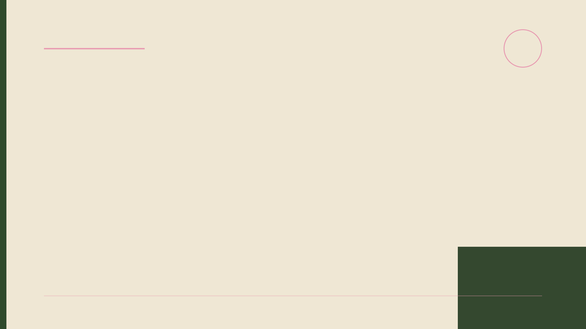
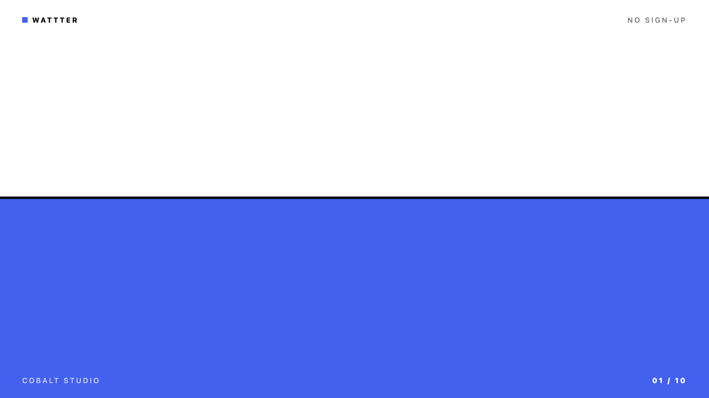
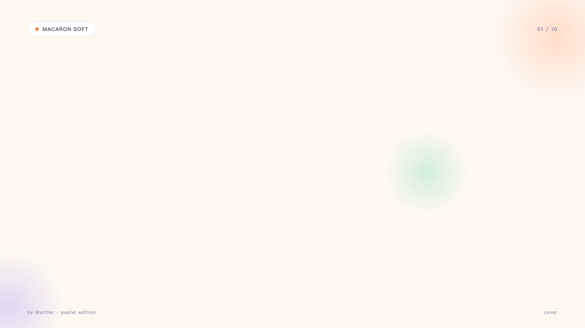
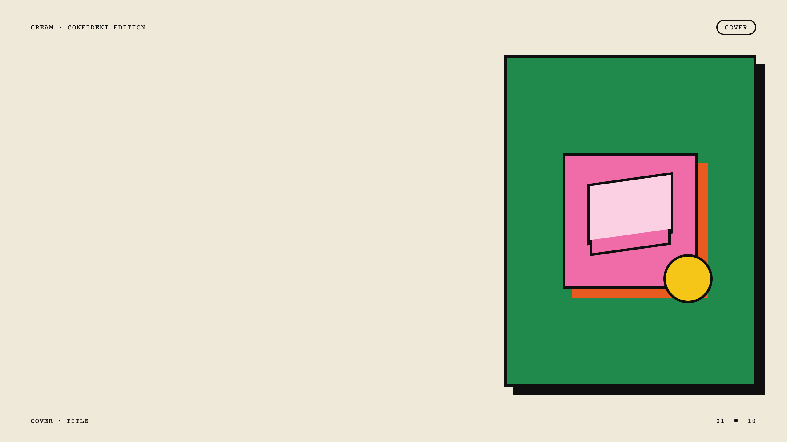
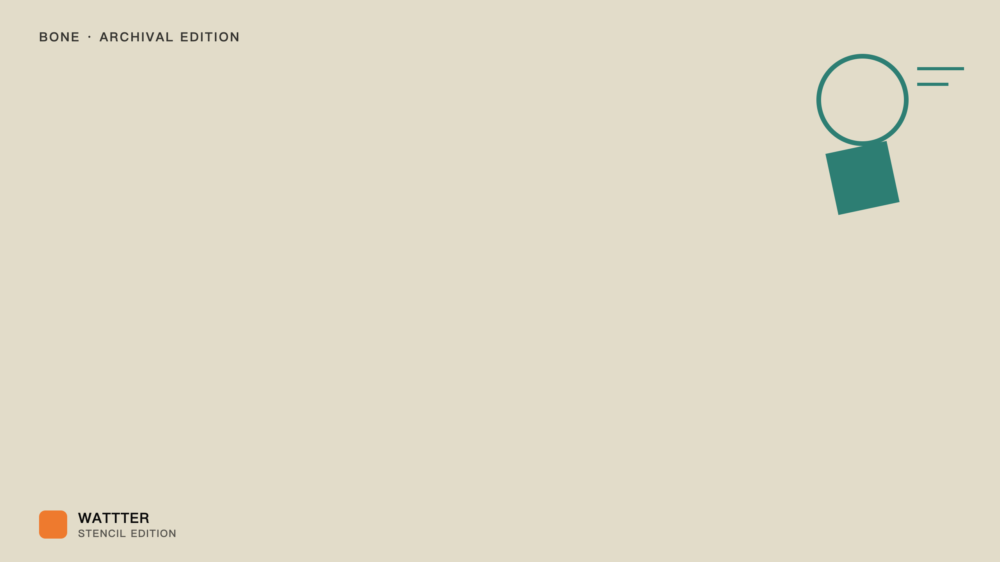

# HTML Background Styles · 索引

> 图层化架构的底层背景层。每个风格是一套 4 个 HTML 模板（cover / ending / chapter / theme），由 [`scripts/html_render.py`](../../scripts/html_render.py) 渲染为 PNG，作为 SVG 页面的全幅背景**首子元素**（z-order 最底层），SVG 文字层叠加其上。HTML **不烘焙任何可编辑文字**——文字以 `<!-- text-slot -->` 坐标注释预留，由 Executor 在 SVG 层放置，保证 PPT 文字可编辑。

## 风格清单

| 风格 | 定位 | 视觉特征 | 兼容色板 |
|---|---|---|---|
| `gradient-panel` | 现代企业通用 | 渐变色块 + 角落几何强调 + 顶部细色带；克制现代 | 全部 |
| `geometric-mesh` | 科技/产品/活力 | 大色块对角分割 + 网格/chevron motif；醒目有力 | tech-cyan / navy-trust / dark-cinematic |
| `editorial-rule` | 高端咨询/学术克制 | 顶部色带 + 发丝线 + 大量留白；编辑型克制 | navy-trust / warm-earth / tech-cyan |
| `forest-editorial` | 文学/季评/品牌叙事/慢内容 | 森林绿竖色带 + 尘粉发丝线/圆环/圆点 + 森林绿大色块；衬线大字区 + 留白；移植自 open-design `fs-editorial-forest` | warm-earth ✓✓ / navy-trust ✓ / tech-cyan ✗ / dark-cinematic ✗ |
| `cobalt-studio` | 品牌发布/产品故事/企业开场 | 50/50 上下分割 + 黑色 9px edge bar 接缝 + 4 角品牌 mark（chip + uppercase）；钴蓝白强对比；移植自 open-design `fs-electric-studio` | navy-trust ✓✓ / tech-cyan ✓ / warm-earth ✗ / dark-cinematic ✗ |
| `macaron-soft` | 小红书/生活方式/节庆/个人随笔 | 奶油底 + 3 个马卡龙径向渐变 blob（桃/薄荷/紫）+ 微模糊 + 顶部药丸 chip + Playfair 斜体大字；移植自 open-design `html-ppt-xhs-pastel-card` | warm-earth ✓✓ / navy-trust ✓ / tech-cyan ✗ / dark-cinematic ✗ |
| `cream-confident` | 潮牌/品牌发布/创意营销/活动宣发 | 奶油底 + 4px 厚黑边 + 黑色偏移阴影 + 5 色撞色（绿/粉/橙/黄/奶油2）+ Archivo Black 极黑大字 + 旋转粉色 stamp；neobrutalism 风格；移植自 open-design `html-ppt-zhangzara-creative-mode` | warm-earth ✓ / dark-cinematic ✓ / navy-trust ✗ / tech-cyan ✗ |
| `bone-archival` | 工业/军工/建筑/纪实/品牌档案/电影海报 | 骨色底 + 7 大地色（赭/品红/橙/青/蓝/芥末/橄榄）+ **Stardos Stencil 镂空字** + Barlow Condensed 标签 + teal 抽象图形 + ending 撞色对（teal×orange）；移植自 open-design `html-ppt-zhangzara-stencil-tablet` | warm-earth ✓✓ / dark-cinematic ✓ / navy-trust ✗ / tech-cyan ✗ |

起步 3 风格共享同一组 slot 坐标；`forest-editorial`（以及后续多色风格）使用各自的 slot 坐标，详见各风格 `slots.json`。

## 兼容矩阵（风格 × 主题色板）

| 风格 \ 色板 | navy-trust | tech-cyan | warm-earth | dark-cinematic |
|---|---|---|---|---|
| gradient-panel | ✓✓ | ✓✓ | ✓ | ✓ |
| geometric-mesh | ✓ | ✓✓ | ✗ | ✓ |
| editorial-rule | ✓✓ | ✓ | ✓✓ | ✗ |
| forest-editorial | ✓ | ✗ | ✓✓ | ✗ |
| cobalt-studio | ✓✓ | ✓ | ✗ | ✗ |
| macaron-soft | ✓ | ✗ | ✓✓ | ✗ |
| cream-confident | ✗ | ✗ | ✓ | ✓ |
| bone-archival | ✗ | ✗ | ✓✓ | ✓ |

`✓✓` = 强推荐；`✓` = 可用；`✗` = 不推荐（气质冲突）。

## 选择规则

- Strategist 在八项确认 h（图像）环节读取本索引，推荐一个风格（或 `custom`）。
- 风格与 `spec_lock.visual_style`（deck 级美学）交叉验证：visual_style 偏克制（如 swiss-minimal）→ 优先 `editorial-rule`；偏活力（如 bold-statement）→ `geometric-mesh`；通用 → `gradient-panel`。
- `custom` 风格：用户可指定自定义 HTML 模板目录（放入 `<project>/templates/html-background-styles/<custom>/`，含 4 个 `.html` + `slots.json`），manifest `style` 填该目录名。`html_render.py` 解析 `style` 时先查 skill 内置 `templates/html-background-styles/<style>/`，再查项目本地 `<project>/templates/html-background-styles/<style>/`（项目本地优先级更高，便于覆盖）。

## text-slot 坐标契约

起步 3 风格（`gradient-panel` / `geometric-mesh` / `editorial-rule`）**共享同一组 text-slot 坐标**（见各风格 `slots.json`，内容一致）：

| 模板 | slot 名 | 坐标矩形 (x1,y1 x2,y2) |
|---|---|---|
| cover | title | 80,280 1200,380 |
| cover | subtitle | 80,400 1200,455 |
| cover | author | 80,625 640,665 |
| cover | date | 660,625 1200,665 |
| ending | thanks | 80,290 1200,400 |
| ending | contact | 80,560 1200,650 |
| chapter | chapter_num | 80,200 460,380 |
| chapter | chapter_name | 80,420 1200,490 |
| theme | （无） | Executor 自由设计内容层 |

多色移植风格（`forest-editorial` 及后续）**slot 坐标可能不同**——以各风格自己的 `slots.json` 为准（如 `forest-editorial` 把 chapter_num 扩到 880 宽、title 起点上提到 y=250）。Manifest `text_slots` 字段在解析阶段由 `html_render.py` 从所选 style 的 `slots.json` 回写，Executor 严格按 manifest 坐标落 `<text>`。

坐标在 1280×720 系（PPT 16:9）。其他画布格式由 `html_render.py` 按 `{{canvas_w}}`/`{{canvas_h}}` 缩放模板根容器；slot 坐标始终在 spec_lock 的 canvas 系下解释（Executor 按 manifest `text_slots` 放置 `<text>`）。

`html_render.py` 渲染时**强制校验** HTML `<!-- text-slot -->` 注释 == `slots.json`，不一致报错；slots.json 是真源，回写到 manifest 的 `text_slots` 供 Executor 读取。

## 模板结构约定

每个风格目录：
- `cover.html` / `ending.html` / `chapter.html` / `theme.html` —— 4 个模板
- `slots.json` —— text-slot 坐标契约
- `<style>.md` —— 风格说明（视觉特征 + slot 契约表 + 兼容色板）

模板变量（`{{var}}` 占位符，由 manifest `variables` 注入）：
- `{{primary}}` `{{accent}}` `{{bg}}` `{{surface}}` `{{border}}` `{{text}}` `{{text_secondary}}` —— 主题色（来自 [theme-palettes](../../references/theme-palettes/_index.md) 或 brand）
- `{{canvas_w}}` `{{canvas_h}}` —— 画布尺寸（自动派生自 manifest canvas）
- `{{logo_href}}` —— logo data URI（来自 brand §IV 图形 mark；无 logo 时 `` 整标签被移除）

## 多色风格的颜色策略

起步 3 风格是单色系（用 `{{primary}}`/`{{accent}}` 即可）。多色移植 5 风格（`forest-editorial` / `cobalt-studio` / `macaron-soft` / `cream-confident` / `bone-archival`）有 2-7 个 DNA 色，策略：

- **风格固定色写死 `:root`**：从源模板提取的 HEX 直接写死（如 `forest-editorial` 的 `--green-deep` #243a21 / `--green-lite` #3a5a36 / `--cream-2` #e6dcc4；`bone-archival` 的 7 大地色）。它们是风格 DNA，不该被色板覆盖。
- **主题角色用 `{{var}}` 覆盖**：与色板对齐的色（primary / accent / bg / surface / text）映射到 manifest theme_palette 的对应字段。Strategist 不传 variables 时渲染原生配色；传 variables 时主题色覆盖主角色，风格固定色保留。
- **优势**：不传 variables = 原汁原味视觉保真；传 variables = 适配 brand/色板。两种使用方式都不破坏风格识别度。

## Inspiration gallery

各风格 cover 缩略图（用 1.0× scale 渲染 1280×720）：

- 起步 3 风格：见各 `<style>.md` 目录的视觉描述（[gradient-panel/](gradient-panel/)、[geometric-mesh/](geometric-mesh/)、[editorial-rule/](editorial-rule/)）
- 移植 5 风格 cover 缩略图：
  - 
  - 
  - 
  - 
  - 

完整渲染管线：用 `html_render.py <project> --manifest <path> --render-md` 即可在 `<project>/images/html_backgrounds.md` 看到本次渲染所有 4 模板的清单 + 状态 + slot 坐标回填。
