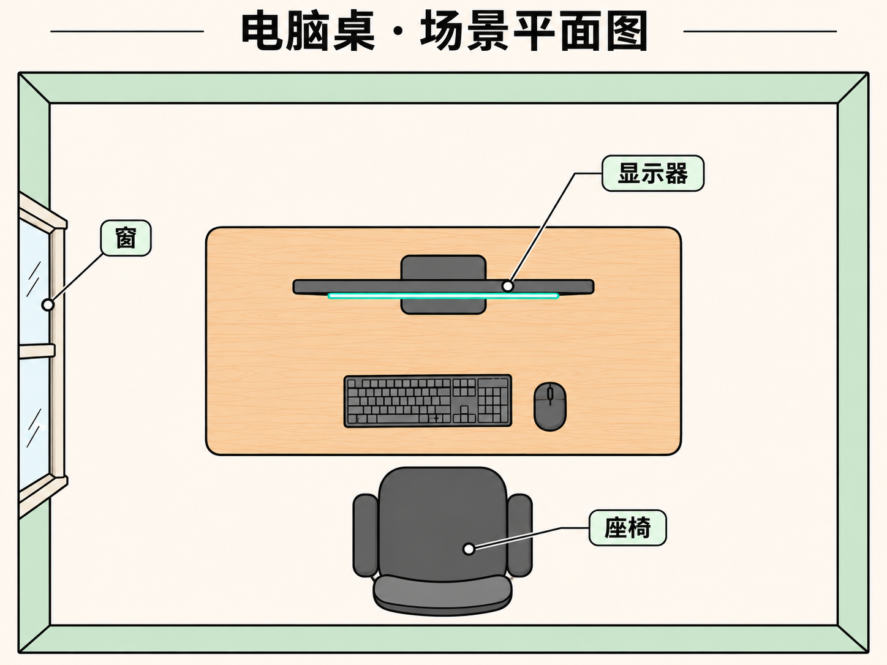
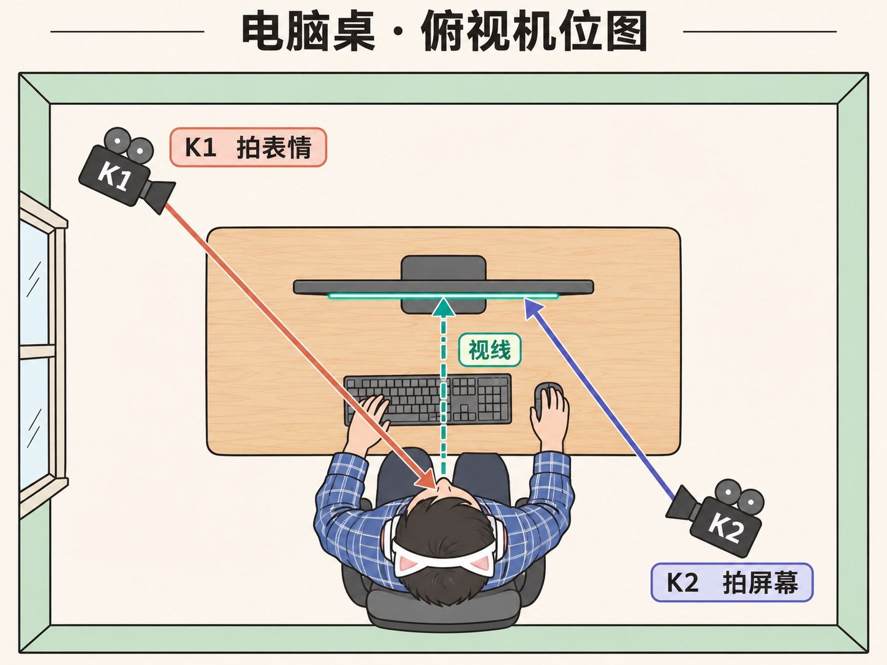

# 分镜和视听设计

## 从剧情目标到镜头

每镜回答：获得什么→看哪里→谁怎样行动→谁先感知与反应→如何连接下镜。漂亮但不提供信息、情绪或空间定向的画面不因“电影感”保留。

```text
依据【定稿剧本及不可改原句】【目标片长、画幅】【已有角色与场景资产版本】，输出分镜表，每个实际镜头一行。
每行先写入镜时谁在哪里、此刻观众能看到什么，再写引发行动的线索、人物的动作与反应、必须听清的原句或声音，最后写出镜状态。选能看清这段表演的景别、机位和运动，注明参考资产及用途。
标出各镜成片区间和所属生成段。同场连续行动按戏合段，既定切点落在相应动作上。将相邻两行连读，核对视线、持物、声源与动作是否接得上，再核对总片长。若台词说不完或动作被取景遮住，标出镜号和可行调整。
```

```text
S01｜成片[起秒,止秒)｜关联SC/B
目的：观众本镜知道什么、感到什么；突出/暂藏什么，为何此刻选该景别、角度与镜头组合。
机位：起点位置/朝向/高度/景别→移动路径与节奏→落点构图；固定镜明确不动。说明观众因此看见什么。
空间：角色与地标的关系、本镜画面左右、持物/姿态/视线。有方向的物品注明使用面朝谁、人物看向哪里，以及从本机位能看见的面或遮挡。
动作：起点→原因→路径/接触→落点；反应先后。
首态/尾态/不变量：人物、物件、背景、光源哪些变、哪些不变。
声音：对白ID、说话者、说/内心独白/画外音、原句、时间窗、音效来源。
连接至【下一镜S或同镜下一段G】｜【接法与此时切换的理由】｜【当前末态】→【下一首态】｜【观众看见或听见什么，从而认出两段的关系】。
主参考：出镜者C及基础形象版本，当前场景L及所需机位。空镜只列L。按需注明辅助图、道具与声音。
制作：参考模式意图、生成段G、素材秒数/余量/保留区间或待核验。
```

### 房间俯视图与机位

同场反打、绕行或多次回场时，先画一张干净的场景平面图。同一场景编号共用一份。用严格俯视画出墙体、已知门窗、家具轮廓、通道、座位和道具使用面，省去人物、视线、摄影机与镜号。没有依据的画外布局标为待定。已有合适的平面图直接采用。



在这张图的副本上叠加人物和机位。两图沿用同一上方、比例和固定物位置，交接时并排核对。用固定的墙或门作为图的上方，标主要家具、人物站位与面向、道具使用面和机位。各机位用 K 编号和拍摄箭头，移动机位画起点、路线和终点。取景高度、俯仰及遮挡写在对应镜号旁。已有可靠底图时按可见地标回填；画外布局属于设计选择，已定布局优先。



绿色虚线从男孩指向屏幕，是视线。橙色 K1 从机壳旁拍脸，蓝色 K2 从男孩右侧斜拍显示面。若分镜要右肩进入前景，将 K2 移到男孩右肩后方，再沿新拍摄方向检查肩、耳机与屏幕的遮挡。

为当前作品画图时可用这条提示，方括号换成实际内容：

> 画一张严格俯视的拍摄平面图，图上方为【固定地标】。按【场景底图或已定布局】摆放【人物、家具及关键道具】，标清【人物面向、视线目标和道具使用面】。在【机位位置】画相机图标，标【K编号与拍摄目的】，实线箭头从镜头指向被摄目标，人物视线用虚线。各机位共用同一布景。

实际绘制的图随作品放在 `02_导演/`，按场景 ID 命名，例如 `L01_场景平面图.png` 与 `L01_俯视机位图.png`。在分镜表嵌入一次，各镜引用场景与 K 编号即可。交接前沿每条视线和拍摄箭头核对目标、可见面与遮挡，再把高度和景别写在对应镜号旁。

## 从剧情选择镜头语言

先读本场的信息变化、关系变化和表演节拍，再选择景别、角度、视点、镜头组合与运动。俯拍是观察角度，特写是取景尺度，正反打是镜头之间的组织方式；可组合为“略俯拍的手部特写”或“平视过肩正反打”，不是三个互斥的运镜选项。

每个被选技巧都回答：**观众此刻看谁/什么→因此获得或暂时失去什么信息→为什么此时改变观看方式→如何接前后镜**。答案写入原有目的、机位与连接字段，不增加技巧报告。下表按需要选用，不按顺序轮用，也不规定每片必须出现几种技巧。

| 技巧 | 可服务的剧情任务 | 落到设计的具体要求 |
| --- | --- | --- |
| 全景/建立镜头 | 建立人物距离、出口、障碍或行动范围 | 哪些空间关系此刻必须看清；已建立且无变化时不重复交代 |
| 中景/双人镜 | 看清互动、身体动作和关系变化 | 谁占画面重心、两人距离、手与道具活动区；能在同框读懂就不机械拆正反打 |
| 近景/面部特写 | 捕捉犹豫、认出、隐瞒等可见反应 | 精确到眼神、呼吸或表情变化与触发时点；不要只写“震惊”；动作所需手部另有覆盖或仍保留入画 |
| 物件/手部插入特写 | 强调线索、接触细节、因果证据 | 拍哪一部位、谁的哪只手、何时首次可见、从何种视线或动作切入；未到揭示时点不露关键文字 |
| 俯拍/顶拍 | 交代桌面布局、行动路线，或结合构图表现人物处境 | 写相机位置/高度、向下角度与覆盖范围；略俯和垂直顶拍分开。不能见到未设计的屋顶/桌面，也不把俯拍固定等同弱小 |
| 仰拍 | 强调尺度、高处目标或特定人物视角与关系 | 写低机位、上仰方向、人物视线及可见背景；不把仰拍固定等同强大，不为气势改变原人物关系 |
| 过肩/正反打 | 表达对话中的距离、立场与信息交锋 | 写A看B/B看A的具体机位、轴线同侧、画面视线方向、前景是谁的哪侧肩和遮挡范围；正反打也可用不带肩的单人镜，不能一人一句机械切换 |
| 反应镜头 | 让观众看到一句话或事件对听者的影响 | 谁先听见/看见，何时开始反应，切去后谁仍在说话；持续对白保留原句与声轨关系，不能让听者误开口 |
| 主观镜头/视线匹配 | 让观众随角色发现信息或限制所知 | 先说明视线来源，再给角色实际能看到的范围；观众提前知道而角色不知时明确采用客观视点，不误标主观 |
| 焦点转移/前后景调度 | 将注意力从前景人/物转到后景线索 | 写焦点起落对象、距离层次和转移时点；焦点变化不等于相机推近，静帧与视频要有可成立的前后景 |
| 长镜/蒙太奇 | 长镜保留连续行动或等待；蒙太奇压缩过程、并置信息 | 按剧情选择连续或省略；长镜明确调度，蒙太奇明确各画面及时间关系，不用术语代替具体镜头，不擅改既定连续要求 |

情绪由表演、构图、声音与上下文共同支持，不为“压迫”自动仰拍、不为“悲伤”自动俯拍。故事需要观众注意的东西必须可见或可听；有意隐瞒的信息不能在资产图或前一镜提前暴露。没有表达收益时保留更清楚的固定中景。

## 机位、运动与光影

- 写清运镜、景别、角度、主体、主体运动、光影；焦段有作用时才给，不把50mm或真实皮肤套给所有动画。
- 推近揭示反应、拉远揭示关系、跟随维持行动；固定/静止有叙事价值就用，不规定正面次数、每镜必动或黄金分割坐标。
- 多人同框时，按开场各自在做什么安排姿势与视线，再让反应随线索传递。例如父亲靠窗、奶奶在桌边看得见他的脸、女孩低头读书。固定机位须同时容得下父亲转头、奶奶起身和女孩抬眼，桌边留出起身空间。需要观众看清谁先察觉，就检查前景会不会挡住那个人。
- 拆分/连拍按可读性选择；接触点、持物手、松开/落点、路径明确。水火/倒影/文字标风险，选可控实现，不禁用整类题材。
- 逐场色光表含主体/背景、强调色对象、光源位置/方向/软硬/冷暖、明暗层级和允许变化。同场换机位光源世界位置不变。雨势、湿衣和风向在相关镜头中延续，变化写明触发点。设计风吹织物时先定来风方向，再看哪一端固定、哪一面受风、哪里有遮挡。
- 复杂空间可按目标画幅做色块草图。已有关键构图时缩至手机观看尺寸，试认关键反应和小道具。若叙事依赖轮廓分离，转灰度检查人物是否融入背景，再调明暗、站位或遮挡。需要隐藏的线索按其揭示时点检查。实际看过才记录结果。九宫格是布局辅助，不是视频控制帧。

### 把运镜落到画面

先选观看目标，再选拍法。需要观众看清手部交接时，留住两人的手和物件；需要发现画外信息时，安排移动后才露出。不要先堆“推拉摇移环绕”，再让剧情迁就运动。

| 拍法 | 必须交代 | 图片需要支持什么 |
| --- | --- | --- |
| 固定 | 不变的机位/景别，主体在画内的路径 | 起止状态都在可见范围，给手、视线和移动留边距 |
| 推/拉 | 相机实际向哪里移动、何时起停、最终取景；若是变焦则明确机位不变 | 推进后的透视与遮挡合理，关键手/物仍入画；不能只缩放人物而背景不变 |
| 摇摄 | 相机位置不动、转向/幅度以何地标为落点 | 原先画外区域有设计，人物与地标不随镜头平移变位置 |
| 横移/跟随 | 相机与人物各自路径、相对距离/速度、遮挡经过与落点 | 留出通道、运动方向与前后景层次；跟拍不等于人物一直保持原地 |

一个镜头优先一个主导运动；叙事需要复合运动时写清先后和衔接，不能只罗列术语。复杂手部接触或重要对白默认降低运镜负担，有明确表达目的才叠加移动，不硬性禁止对白时运镜。

在既有动作时间线上并列写相机状态。例如“0—1秒站定看信/相机固定；1—3.5秒举信/相机缓推；3.5—4秒持信/相机减速；4—5秒持信/相机停稳”。首尾帧分别对应第一和最后时刻；动作/机位中途的关键变化写视频，不画进同一静帧。时间只是具体设计，不是固定分段模板。

### 先选连接，再决定用图

| 连接 | 设计与交接要求 |
| --- | --- |
| 同镜续接 | 用户指定分界或请求时长上限迫使同一S分为多个G时，选动作交接或对白落句处。接点对齐相机位置、朝向、景别、人物姿态与道具；运动中续接方向和速度 |
| 切镜 | 新S，写切点依据；换机位/景别须新画面，不共享同一F。动作匹配核对接触阶段/持物手/屏幕方向；对视核对轴线与视线；听者反应可承接不断的对白 |
| 时空转换 | 明确时间/地点改变及让观众识别的线索；不要求沿用旧空间和动作状态，也不靠自动变形完成转场 |

相邻同向同景别若无信息增量容易形成无意跳切，先判断应续拍还是改观看重点。反打先在人物连线同侧安排机位并推导画面左右；有意越轴需给出重新定位依据。切镜前后可以动作/视线/声音关联，但“关联”不等于首尾同图。按实际能力选择一次多镜生成或分开生成后剪辑，不能同时要求无切镜和正反打。

### 相邻镜头的接点

在前镜的“连接”栏写一次接点。用一句能拍出来的话回答“为什么现在切，观众靠什么跟过去”。例如“指尖停在东桥 → 切回三人，指尖仍在东桥，张飞低头顺着手指看地图 → 等他看明白，再让他问借粮”。末镜写收束状态，有跨集接点时注明后续承接。

逐对回读时，只核对本接点涉及的内容。

| 核对什么 | 看切点两侧能否对上 |
| --- | --- |
| 空间和视线 | 以地标和人物连线为准，推导新角度的左右、视线落点和进出方向。切去角色看到的物件时，先让观众知道是谁在看、物件在哪里。 |
| 动作和道具 | 对齐动作进行到哪一步、哪只手在动、物件朝向与持有人。伸手途中切近景，近景从伸手途中接起。 |
| 信息和情绪 | 对齐角色所见所闻与反应的时点。给发现、迟疑或决定留出可表演的时间。反应所需的剧情线索若缺失，交编剧核对。 |
| 画面和声音 | 同场对照衣着、光源位置、时段和环境底噪。对白跨切点时写明谁的哪句继续、何时结束，以及新画面里谁在听。 |

同镜拆G时，还要对读相机和主体在接点的方向、速度和停顿，共享F只记录为符合构图条件的候选。省略时间时写清哪些状态可以变化，以及观众怎么知道时间过去了，例如从天亮时刚点燃的油灯切到夜里将尽的灯芯。若发现断点，指出具体镜号对及会造成的误读，优先在已有镜头中调整动作阶段、视线、声轨或切点。

## 美术与首尾状态

先按镜号归集出镜角色和实际场景。每个出镜角色对应一个采用的基础形象，每处场景至少有一张底图。群演可用已采用的群像资产，空镜只对应场景图。同一物理场所的切角度与回场共用场景ID，切到其他场所时列其场景底图、空间锚点及使用镜号。缺图标待制作。其他图片按构图或美术需要选用。

人物继承编剧事实，补材料/服装/轮廓等制作需要，不擅改身份与自身侧别。派生以同一选定基础形象为依据，避免身份逐代漂移。

人物已有合格基础形象直接复用。完整制作可为需要核对多角度外观的主要角色补身份板，关注脸、发、体型、服装、鞋及侧别标记。场景列一张核心底图、门窗/陈设/尺度/通道/光源的固定空间锚点，按需列最多三个不同机位，均从首张环境底图直接派生，剩余视角在分镜中描述；基准未显示的区域先补设计，不让各机位各自猜。派生关系在同一卡内表达，不要求新增MD。

正反打根据坐标、轴线、机位推导门窗和遮挡，不机械翻转。纯场景排除人/倒影/剪影，站位在文字、定位板与镜头帧表达。

多人同框时，先写清相对体型、坐立高度、前后距离或遮挡等影响动作辨识的关系。已有预演图或F可辅助核对。例如一人坐在案后，两人站在案前，画面需同时容纳后方人物看向地图的视线和坐者指图的手。资产需求注明所用镜号、拟复用图和要核对的关系。切场先为目标场所采用其场景图，确需进一步校准构图时可建议制作一张同框辅助图。

首尾帧分别设计起点、终点和可行路径；复杂镜可倒推终点，普通镜自然顺序。支持双端才绑定双端；首帧、多参考、纯文本各有边界，两张上传图不等于首尾帧模式。

起止状态不等于每镜必须新生两张图。仅当换场或明显换机位且已有角色、场景参考不足以说明新构图时，提出新制F需求；模式必需端点优先复用已有图或剪点帧，注明对应S/G、时点及需看清什么；同一时刻且接点构图、相机姿态、人物道具及光色一致时，可标“前段尾帧=后段首帧”的共享候选，交制作核实。换机位/景别、跳时空时分别设计画面状态；已有机位图能说明新空间、或普通特写能用文字交代时，无需增设F；静态卡面可共用。实拍/录屏仅需文字状态时不强制建F资产。旧F编号保留映射，一镜多段按G登记接点；最终媒体复用和抽帧采用由制作负责。

## 声音设计

角色音色卡含年龄感、音域/质地、口音、常态语速、气息、情绪幅度；本场表演另列，不能把哭腔永久写成身份音色。参考音频的来源/授权/版本交制作核对。

- `说`：可见开口需要口型。
- `内心独白`：人物不因这段音轨开口。
- `画外音`：本镜看不见发声者，仍有说话者/来源，不自动改全知旁白。

```text
为【剧本/分镜】设计声音：每位角色一张固定音色卡，逐句另列语气、停顿、重音与声音类型。
比较同期对白、先配音后对口型的条件；不能实现时列缺口，不改原句。
环境声注明画内/已建立的画外来源；音乐给情绪、进入/停止位置及对白避让。
音频需求标角色/对白/镜号和版本，无实际音频时标待制作。
```

配乐按整场/全片规划，不让每个视频段各自随机配乐；音乐驱动作品先按已选原始音轨设计节拍。声音描述不保证稳定，实际参考/配音与试听仍需核对。

## 用样片确定后续各集的拍法

连载开始或画风、表演、对白路线发生变化时，从本来就要制作的戏里挑一段最能检验分歧的表演。已有采用样片就引用其版本和时码。可将下面的提示用于导演方案。

> 从【已定分镜】选出一段，写明观众必须看懂什么、必须听清什么，以及后续同类镜头沿用哪项决定。例如城门盘查可用一个双人中景拍完：咳声从车帘内传出，老卒停下放行的手，送粮人看向他。试看片中听得出声源、看得清二人反应先后，这段才适合用来定表演节奏。将实际采用的画面、声音与适用范围写回制作交接。

样片长度随验证目标确定。只有对白才决定表演节奏时，写明采用原生对白还是另配音。粗剪优先用对白、动作声和必要环境声验证信息，再判断配乐是否盖住线索。

## 成片镜头与生成段

成片镜头区间、生成素材区间、剪辑保留区间分别记录。余量不增加定稿片长，关键动作/台词必须在保留区间。

- 3秒镜头可生成4秒、保留0.5—3.5秒。
- 同机位对话6秒说完即可收镜，递交一件物品连同对方反应需要12秒且模式可容纳，就用一条12秒提示词。停顿、接物或换说话人都可以是镜内节拍。
- 18秒长镜遇到已确认的15秒请求上限，才按该上限拆成两个续段。沿用S01，在自然接点交代下一段的起始动作与声音。通道能容纳整镜时保留一个G。
- 同空间多个短镜可合一个生成段，逐镜标切点和覆盖；不跨不相容时空合段。
- 全能参考可用时，从当前节拍起向后评估合并。看人物、空间、光线能否沿用，动作和对白能否连读，逐镜能否明确映射到角色图和对应的场景图。小幅推近、道具近景、同场听者反应都可以放进一个G。按用户指定的15秒上限计算含余量的素材时长，短戏按原节奏收束。若下一拍将超限，或换时空、大幅调度导致参考互相冲突，在最近的动作完成、对白落句或既定切点分G，写清下一段从哪里接起。其他通道采用其实际可用时长。
- 用户以“分镜”命名的叙事单元若内含“切至”新画面，交接时保留原单元名/时长，并映射到实际S及G；明确每个S的时间、动作、声音和参考图用途。单张预演图可能只覆盖其中一个构图，未看图不承诺其覆盖范围；不因镜头编号细化而增加MD。
- 能力未知只给设计意图，制作核实后补映射，不假报任意长度均支持。

交接核对节拍覆盖、原句、总时长、道具起止、入场来源及资产需求；逐镜对齐机位起止、相机与主体时间线、静帧取景和下一段接法。同空间可读的连续行动优先评估合段，减少反复重建场景；不为凑平台长度塞动作，也不因后端拆段自动新增剪辑点。制作反馈不能实现时回改相关设计，不整片重做。
